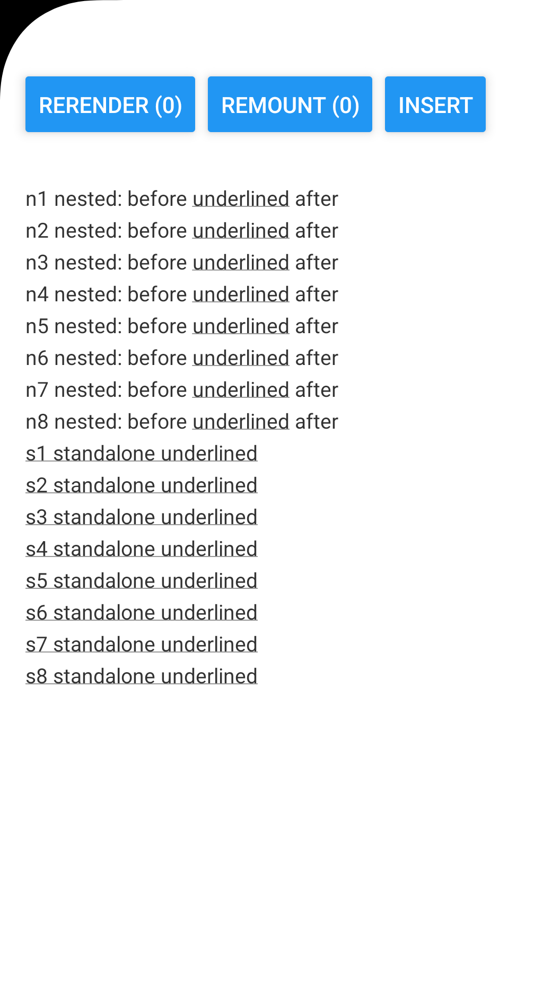
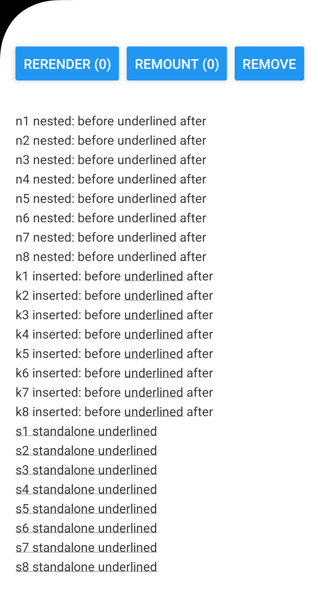

# RN 0.87.1 Android: underline disappears from an unchanged Text after a sibling is inserted

Minimal reproducer for a React Native issue, created from the [reproducer template](https://github.com/react-native-community/reproducer-react-native).

- React Native 0.87.1, New Architecture, Hermes
- Android only — iOS keeps the underline in every case
- All code is in [`ReproducerApp/App.tsx`](ReproducerApp/App.tsx)

## Steps

```sh
cd ReproducerApp
yarn install
yarn android
```

1. On launch every row is underlined.
2. Tap **INSERT**. Eight rows are inserted between the `n` rows and the `s` rows.
3. The `n` rows, which did not change and did not move, lose their underline. The inserted `k` rows and the shifted `s` rows keep theirs.

**RERENDER** (parent state change only) and **REMOUNT** (key change) do not trigger it.

| Before | After tapping INSERT |
| --- | --- |
|  |  |

Pixel 9 Pro emulator, Android 16 (API 36).
